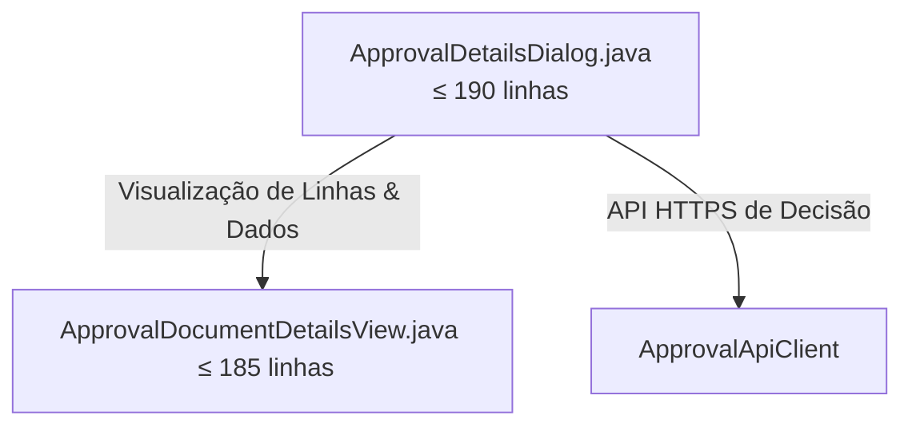

# Especificação Técnica: Decomposição de ApprovalDetailsDialog

- **Document ID**: SPEC-APPROVAL-DETAILS-DIALOG-DECOMPOSITION-001
- **Fase**: 76
- **Data**: 2026-10-25
- **Estado**: Aprovado
- **Módulo**: `desktop` (`mz.multicore.erp.gui`)

---

## 1. Contexto e Motivação

O diálogo modal `ApprovalDetailsDialog.java` (486 linhas) é o dossiê executivo de decisão de aprovação corporativa do ERP. Permite aos gestores e diretores inspecionar linhas de artigos, quantidades, armazéns, clientes e emitir aprovação autoritativa ou rejeição justificada para transferências de stock, encomendas de clientes, quebras e despesas.

O diálogo concentra a construção das grelhas específicas de cada tipo de documento (`STOCK_TRANSFER`, `ORDER`, genérico) e respectiva impressão de guias em PDF.

Esta fase decompõe o diálogo extraindo a visualização de detalhes documentais para `ApprovalDocumentDetailsView.java`.

---

## 2. Arquitetura Alvo e Decomposição Modular

### Componentes Especializados

1. **`ApprovalDetailsDialog.java`** (Orquestrador, $\le 190$ linhas):
   - Construtores e métodos estáticos `show(...)` preservados rigorosamente.
   - Construção do cartão superior de cabeçalho (`buildHeaderCard`), abas corporativas e barra inferior de ações de decisão (`buildActionsBar`).
   - Ações de rejeição com motivo obrigatório e aprovação com `ModernMessageDialog.confirm`.
   - Zero diálogos legados `JOptionPane`.

2. **`ApprovalDocumentDetailsView.java`** ($\le 185$ linhas):
   - Constrói o painel de detalhes do documento inspecionado.
   - Monta resumo e grelha de linhas para transferências de stock com impressão via `SensitivePrintCoordinator`.
   - Monta resumo e grelha de linhas com totais para encomendas comerciais.
   - Renderiza especificações genéricas em área estilizada de texto.

---

## 3. Tetos de Linhas de Código

| Ficheiro | Linhas Anteriores | Teto Estrito Pós-Refatoração |
|---|---|---|
| `gui/ApprovalDetailsDialog.java` | 486 | $\le 190$ |
| `gui/ApprovalDocumentDetailsView.java` | *Novo* | $\le 185$ |

---

## 4. Critérios de Aceitação Não Negociáveis

1. **Compilação e Arquitetura:** Respeitar o isolamento físico multi-módulo Maven (`desktop` depende apenas de `contracts`).
2. **Zero `JOptionPane`:** Nenhuma chamada direta a `JOptionPane.` nos ficheiros refatorados e criados.
3. **Preservação de Assinaturas Públicas:** Os métodos estáticos `show(...)` de `ApprovalDetailsDialog` mantêm exatamente os mesmos parâmetros e comportamento.
