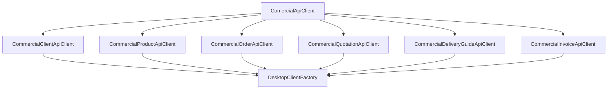

# Especificação de Decomposição - ComercialApiClient (Fase 93)

## 1. Contexto e Diagnóstico

O ficheiro `desktop/src/main/java/mz/multicore/erp/desktop/client/ComercialApiClient.java` acumulava **622 linhas** de código com múltiplas responsabilidades de comunicação HTTP com o backend para diferentes subdomínios comerciais:
1. Clientes e Análise de Crédito/Aging.
2. Artigos, Catálogo POS e Barcodes.
3. Encomendas, Picking, Separação e Fulfillment.
4. Cotações comerciais, envio e conversões.
5. Guias de Remessa e reposição interna.
6. Faturas, Prestações, Radar de Cobranças e Recibos.

## 2. Objectivos da Refactorização

1. **Princípio da Responsabilidade Única (SRP):** Cada subdomínio comercial possui um cliente HTTP autónomo, injetável de forma independente no Spring Boot Desktop.
2. **Decomposição Física:**
   - `CommercialClientApiClient.java` ($\le 60$ linhas): Gestão de clientes, limites de crédito e mapa de antiguidade de saldos (aging).
   - `CommercialProductApiClient.java` ($\le 140$ linhas): Artigos, pesquisa paginada, catálogo POS com leitor de código de barras, categorias, taxas de IVA e imagens.
   - `CommercialOrderApiClient.java` ($\le 150$ linhas): Encomendas de clientes, picking, separação, fulfillment, aprovações, cancelamentos e eventos.
   - `CommercialQuotationApiClient.java` ($\le 105$ linhas): Cotações (propostas comerciais), ciclo de vida, conversão para encomendas e faturas, e impressão.
   - `CommercialDeliveryGuideApiClient.java` ($\le 75$ linhas): Guias de remessa directas e avulsas, aprovação, rejeição, anulação e conversão de encomendas para transferências.
   - `CommercialInvoiceApiClient.java` ($\le 185$ linhas): Faturas comerciais, liquidação, anulação, planos de prestações, radar preventivo de cobranças, devoluções (sales return) e recibos.
   - `ComercialApiClient.java` ($\le 225$ linhas): Fachada/Orquestrador canónico delegador com 100% de compatibilidade retrocompatível.
3. **Zero Regressões:** Todos os métodos, parâmetros, DTOs e tipos de retorno existentes em `ComercialApiClient` permanecem idênticos.
4. **Zero JOptionPane:** Comunicação estrita via records e DTOs tipados.

## 3. Arquitectura dos Componentes

