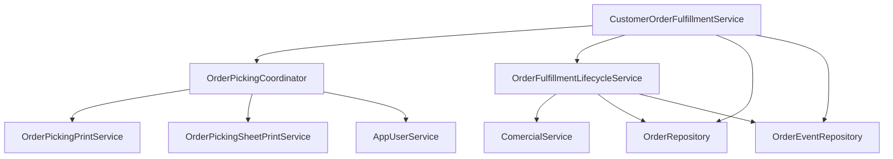

# Especificação de Decomposição - CustomerOrderFulfillmentService (Fase 120)

## 1. Contexto e Diagnóstico

O serviço `backend/src/main/java/mz/multicore/erp/modules/comercial/service/CustomerOrderFulfillmentService.java` acumulava **342 linhas**, misturando múltiplas responsabilidades do circuito de separação e expedição de encomendas de clientes:
1. Emissão e autorização de impressão de guias de separação (picking térmico 80mm e folha A4) com controlo de segunda via/reimpressão e autorização de gerente/administrador.
2. Agregação de linhas de picking com decomposição em caixas/embalagens por volume (`packagesPerBox`, `unitsPerPackage`).
3. Gestão da máquina de estados do circuito de separação (`AWAITING_SEPARATION` -> `IN_SEPARATION` -> `SEPARATED` -> `INVOICED`), conferência óptica de código de barras/lote e facturação com dedução de stock.
4. Rasto auditado de eventos de transição (`OrderEvent`) e submissão idempotente com reserva atómica de stock.

## 2. Objectivos da Refactorização

1. **Princípio da Responsabilidade Única (SRP):** Desacoplar a coordenação de impressão/picking e a máquina de estados de separação em serviços dedicados.
2. **Decomposição Física:**
   - `OrderPickingCoordinator.java` ($\le 195$ linhas): Coordenação de impressão da lista de separação (POS térmica e A4), autorização de reimpressão com autenticação em tempo real de supervisor e cálculo analítico de linhas de picking com conversão em caixas (`OrderPickingDetailsDTO`).
   - `OrderFulfillmentLifecycleService.java` ($\le 135$ linhas): Conclusão de separação (manual ou por conferência óptica de leitor/lote), facturação com dedução física de stock, barreiras contra vias inválidas (`requireSeparationCircuit`) e mensagens amigáveis em pt-MZ orientadas à acção.
   - `CustomerOrderFulfillmentService.java` ($\le 160$ linhas): Orquestrador central protegendo a submissão idempotente de pedidos (`submit`), reserva atómica de stock e consulta do histórico de eventos.
3. **Preservação de Contratos e Retrocompatibilidade:**
   - Construtor canónico `@Autowired` recebendo os colaboradores desacoplados.
   - Construtores retrocompatíveis de 7 e 8 parâmetros preservados para 100% de compatibilidade com os testes existentes (`CustomerOrderFulfillmentHarnessTest`).

## 3. Arquitectura dos Componentes

