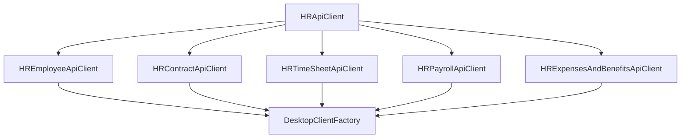

# Especificação de Decomposição - HRApiClient (Fase 94)

## 1. Contexto e Diagnóstico

O ficheiro `desktop/src/main/java/mz/multicore/erp/desktop/client/HRApiClient.java` acumulava **473 linhas** de código misturando múltiplos subdomínios de recursos humanos:
1. Funcionários, Medicina no Trabalho e Documentos Pessoais.
2. Contratos de Trabalho, Alertas de Caducidade e Impressão de Contrato.
3. Assiduidade, Picagens de Ponto, Faltas e Férias.
4. Processamento Salarial, Recibos de Vencimento, 13.º Mês, Subsídios de Férias, Períodos de Folha e Ficheiro Bancário.
5. Despesas, Evolução Salarial, Horas Extras, Retenções e Cessação/Acerto Final.

## 2. Objectivos da Refactorização

1. **Princípio da Responsabilidade Única (SRP):** Cada subdomínio de RH possui um cliente HTTP autónomo, injetável no Spring Boot Desktop.
2. **Decomposição Física:**
   - `HREmployeeApiClient.java` ($\le 110$ linhas): Funcionários (CRUD, alteração de estado), Medicina no Trabalho (exames periódicos/admissão, ficha de aptidão, prestadores, custos) e Documentos de Funcionários.
   - `HRContractApiClient.java` ($\le 65$ linhas): Contratos laborais, ativação, renovação, termo, alertas de fim de contrato/período experimental e impressão em PDF.
   - `HRTimeSheetApiClient.java` ($\le 100$ linhas): Folha de ponto mensal, picagens, fecho/reabertura de ponto, faltas (registo, eliminação, justificação) e marcação/decisão de férias.
   - `HRPayrollApiClient.java` ($\le 130$ linhas): Processamento mensal, recibos de vencimento (aprovação, pagamento, impressão), períodos de folha, ficheiro bancário SEPA/SIMO, 13.º mês e subsídio de férias.
   - `HRExpensesAndBenefitsApiClient.java` ($\le 105$ linhas): Reembolso de despesas, evolução e histórico salarial, acréscimos de horas extras, retenções/obrigações legais, deduções e acerto de cessação contratual.
   - `HRApiClient.java` ($\le 185$ linhas): Fachada/Orquestrador canónico delegador com 100% de compatibilidade retrocompatível com todos os ecrãs e testes.
3. **Zero Regressões:** Assinaturas de métodos e caminhos HTTP preservados na íntegra.

## 3. Arquitectura dos Componentes

