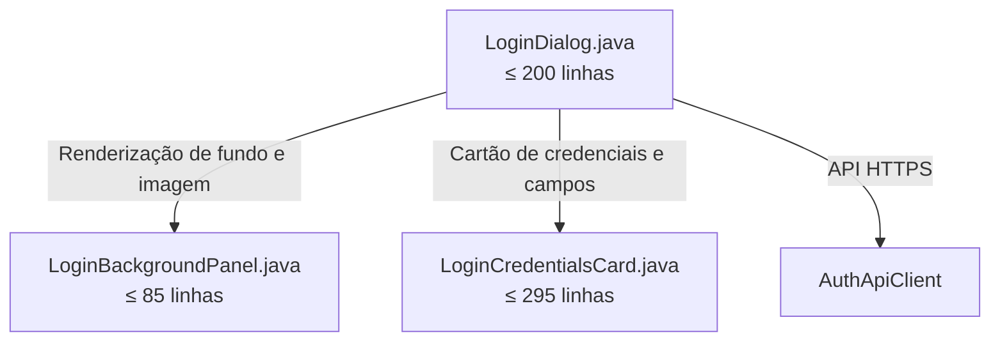

# Especificação Técnica: Decomposição de LoginDialog

- **Document ID**: SPEC-LOGIN-DIALOG-DECOMPOSITION-001
- **Fase**: 75
- **Data**: 2026-10-25
- **Estado**: Aprovado
- **Módulo**: `desktop` (`mz.multicore.erp.gui`)

---

## 1. Contexto e Motivação

O `LoginDialog.java` (585 linhas) é a janela principal de autenticação do Multicore ERP executada no arranque da aplicação. Apresenta uma imagem corporativa em tela cheia com overlay luminoso suave, barra de marca no topo, rodapé com informações legais e acesso ao `AboutDialog`, além de um cartão centralizado de credenciais com suporte a Caps Lock, alternância de visibilidade de senha, contas de demonstração e submissão assíncrona contra o backend fora do EDT via `SwingWorker`.

Esta fase decompõe o monólito `LoginDialog.java`, preservando 100% dos métodos de inspeção e acessibilidade consumidos pelos harnesses de navegação corporativa (`UiOrganizationNavigationHarnessTest`).

---

## 2. Arquitetura Alvo e Decomposição Modular

### Componentes Especializados

1. **`LoginDialog.java`** (Orquestrador, $\le 200$ linhas):
   - Herda de `JFrame`, gere o ciclo de vida da janela, foco inicial, listeners de janela e teclado (ESC para cancelar).
   - Constrói barra superior de marca e rodapé corporativo com atalho para `AboutDialog`.
   - Coordena a tentativa de autenticação via `SwingWorker` chamando `authApiClient.login(username, password)`.
   - Delega métodos getters retrocompatíveis para `LoginCredentialsCard`.

2. **`LoginBackgroundPanel.java`** ($\le 85$ linhas):
   - Encapsula o carregamento seguro do recurso `/images/login-bg.jpg`.
   - Renderiza a imagem de fundo em modo 'cover' preservando proporções com interpolação bilinear.
   - Aplica a sobreposição translúcida luminosa clara e gradiente vertical suave para tema acolhedor.

3. **`LoginCredentialsCard.java`** ($\le 295$ linhas):
   - Constrói o cartão frosted `ModernPanel(20)` centralizado.
   - Constrói os campos de utilizador e senha com ícones FontAwesome corporativos e acessibilidade.
   - Detecção de Caps Lock e botão com alternância de visibilidade da senha (olho aberto/fechado).
   - Botões harmonizados de "Cancelar" e "Entrar" e barra de progresso indeterminada.
   - Painel opcional de contas demo (`multicore.demo-login`) e método `fillCredentials`.

---

## 3. Tetos de Linhas de Código

| Ficheiro | Linhas Anteriores | Teto Estrito Pós-Refatoração |
|---|---|---|
| `gui/LoginDialog.java` | 585 | $\le 200$ |
| `gui/LoginCredentialsCard.java` | *Novo* | $\le 295$ |
| `gui/LoginBackgroundPanel.java` | *Novo* | $\le 85$ |

---

## 4. Critérios de Aceitação Não Negociáveis

1. **Compilação e Arquitetura:** Respeitar o isolamento físico multi-módulo Maven (`desktop` depende apenas de `contracts`).
2. **Zero `JOptionPane`:** Nenhuma chamada direta a `JOptionPane.` nos ficheiros refatorados e criados.
3. **Preservação de Contratos de Navegação:** `UiOrganizationNavigationHarnessTest` (nav00, nav01And02, nav03) continua 100% aprovado.
