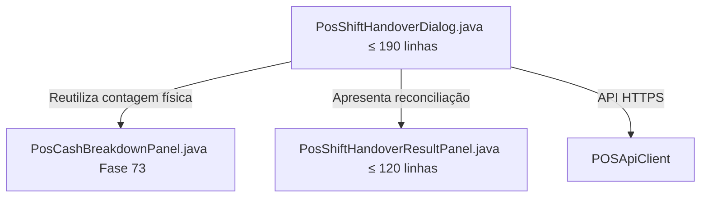

# Especificação Técnica: Decomposição de PosShiftHandoverDialog

- **Document ID**: SPEC-POS-SHIFT-HANDOVER-DIALOG-DECOMPOSITION-001
- **Fase**: 74
- **Data**: 2026-10-25
- **Estado**: Aprovado
- **Módulo**: `desktop` (`mz.multicore.erp.gui.pos`)

---

## 1. Contexto e Motivação

O diálogo `pos/PosShiftHandoverDialog.java` (541 linhas) é o diálogo modal de passagem de turno entre operadores no Ponto de Venda (POS). Ele permite a contagem cega da gaveta física e a seleção do operador seguinte, registando a reconciliação parcial sem fechar a sessão.

Antes desta fase, o diálogo duplicava integralmente a lógica de contagem de dinheiro (notas e moedas de Moçambique, recálculo reativo, alternância entre contagem física discriminada e valor direto, serialização JSON), a qual foi canonicamente encapsulada no componente corporativo `PosCashBreakdownPanel.java` na Fase 73.

Esta fase elimina a duplicação, reutiliza `PosCashBreakdownPanel` e extrai o cartão de resultado de reconciliação para `PosShiftHandoverResultPanel.java`.

---

## 2. Arquitetura Alvo e Decomposição Modular

### Componentes Especializados

1. **`PosShiftHandoverDialog.java`** (Orquestrador, $\le 190$ linhas):
   - Construtor público canónico: `public PosShiftHandoverDialog(Window owner, POSApiClient posApiClient, TillSessionDTO session, Runnable onSuccess)`.
   - Montagem do layout em modal canónico (`BorderLayout.NORTH` com cabeçalho, `CENTER` com scroll de conteúdo, `SOUTH` com botões de fecho e confirmação).
   - Campo para introdução do username do operador seguinte.
   - Reutilização canónica de `PosCashBreakdownPanel.addTo(content)`.
   - Integração de `PosShiftHandoverResultPanel.component()`.
   - Zero diálogos legados `JOptionPane` (utilização estrita de `ToastManager` e `FeedbackType`).

2. **`PosShiftHandoverResultPanel.java`** ($\le 120$ linhas):
   - Encapsula o cartão `ModernPanel(12)` de resultado de reconciliação de turno.
   - Exibe os montantes: Esperado pelo sistema, Contado pelo operador e Diferença auditada (com cor semântica: verde para exato, amarelo para sobra, vermelho para quebra).
   - Apresenta feedback visual amigável e legível.

---

## 3. Tetos de Linhas de Código

| Ficheiro | Linhas Anteriores | Teto Estrito Pós-Refatoração |
|---|---|---|
| `pos/PosShiftHandoverDialog.java` | 541 | $\le 190$ |
| `pos/PosShiftHandoverResultPanel.java` | *Novo* | $\le 120$ |

---

## 4. Critérios de Aceitação Não Negociáveis

1. **Compilação e Arquitetura:** Respeitar o isolamento físico multi-módulo Maven (`desktop` depende apenas de `contracts`).
2. **Zero `JOptionPane`:** Nenhuma chamada direta a `JOptionPane.` nos ficheiros refatorados e criados.
3. **Preservação de Comportamento:** A passagem de turno continua a submeter `ShiftHandoverRequest` com operador cessante, operador seguinte, montante contado, JSON de contagem e notas.
