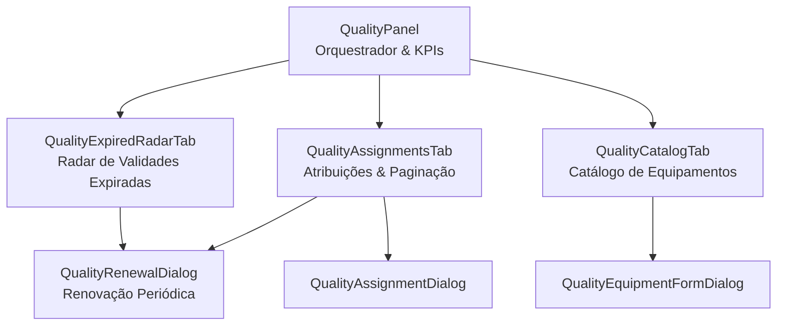

# Especificação Arquitetural: Decomposição Modular do Painel de Qualidade e HST

**Documento:** `SPEC-QUALITY-PANEL-DECOMPOSITION-001`  
**Data:** 2026-10-24  
**Alvo:** `mz.multicore.erp.gui.QualityPanel` (610 linhas $\rightarrow \le 130$ linhas)  
**Pacote Especializado:** `mz.multicore.erp.gui.quality`  
**Status:** Aprovado  

---

## 1. Contexto e Diagnóstico

O painel `QualityPanel.java` foi desenvolvido para o módulo de Qualidade, HST e Equipamentos dos Trabalhadores, agregando 4 KPIs superiores, 3 abas operacionais completas, modais de renovação e emissão de termos de responsabilidade.
Embora bem construído com componentes modernos (`ModernPanel`, `KpiCard`, `TableFilter.bar`, `ActionMenuButton`), o ficheiro acumulou 610 linhas concentrando quatro responsabilidades distintas:
1. Orquestração de KPIs corporativos e abas de topo.
2. Gestão de atribuições a colaboradores, paginação remota, filtros por estado, devolução e emissão de termo.
3. Radar proativo de equipamentos com validade expirada ou a expirar.
4. Catálogo geral de equipamentos de proteção (EPIs) e ferramentas com prazos e parametrizações de aviso prévio.
5. Construção inline do diálogo modal de renovação periódica com `DateField` e geração de PDF.

## 2. Metas de Decomposição

1. **Redução de Tamanho:** Reduzir `QualityPanel.java` de 610 linhas para $\le 130$ linhas (redução $> 75\%$).
2. **Separação de Responsabilidades (SRP):**
   - `QualityAssignmentsTab.java`: Aba "Atribuições a Colaboradores" com paginação `TablePager`, filtros, devoluções e termo de entrega ($\le 180$ linhas).
   - `QualityExpiredRadarTab.java`: Aba "Radar de Validades Expiradas" com listagem analítica de atrasos e acionamento de renovação ($\le 140$ linhas).
   - `QualityCatalogTab.java`: Aba "Catálogo de Equipamentos" com cadastro, edição e filtros de busca ($\le 140$ linhas).
   - `QualityRenewalDialog.java`: Diálogo modal canónico de renovação periódica com `DateField` e limites universais (`UIHelper.applyStandardModalBounds`) ($\le 95$ linhas).
3. **Preservação Estrita de Contratos:**
   - Construtores sobrecarregados:
     - `public QualityPanel(QualityApiClient qualityApiClient, HRApiClient hrApiClient)`
     - `public QualityPanel(QualityApiClient qualityApiClient, HRApiClient hrApiClient, PrintApiClient printApiClient)`
   - Métodos públicos: `onPanelSelected()`, `refreshAll()`.
   - Compatibilidade total com `QualityModuleUiHarnessTest` (3 abas com títulos "Atribuições a Colaboradores", "Radar de Validades Expiradas", "Catálogo de Equipamentos").
4. **Zero Modais Legados:** Garantir 0 ocorrências de `JOptionPane`.

## 3. Arquitetura Proposta

## 4. Estrutura dos Componentes

### 4.1. `QualityPanel.java` ($\le 130$ linhas)
- Coordena os 4 KPIs de topo via `KpiCard.createGrid(4, 8, 8)`:
  - Atribuições Ativas (`activeAssignmentsVal`, `ACCENT_BLUE`, `fas-clipboard-check`)
  - A Expirar em 30d (`expiringSoonVal`, `PENDING_YELLOW`, `fas-exclamation-circle`)
  - Validade Expirada (`expiredVal`, `REJECTED_RED`, `fas-exclamation-triangle`)
  - Equipamentos Cadastrados (`totalEquipmentsVal`, `APPROVED_GREEN`, `fas-boxes`)
- Instancia e adiciona as 3 abas especializadas a `JTabbedPane` com `UIHelper.styleTabbedPaneMulticore`.
- `loadKpis()` assíncrono com atualização dos valores.
- `refreshAll()` cascateia para KPIs e para as 3 abas.

### 4.2. `QualityAssignmentsTab.java` ($\le 180$ linhas)
- Tabela com 9 colunas (`ID`, `Colaborador`, `Departamento`, `Código`, `Equipamento`, `Qtd`, `Entrega`, `Validade`, `Estado`).
- Coluna 0 (ID) oculta; Coluna 8 estilizada com cores semânticas vibrantes (`REJECTED_RED`, `PENDING_YELLOW`, `APPROVED_GREEN`).
- Filtros em linha única via `TableFilter.bar(assignmentsSearchField, assignmentsStatusFilter)`.
- Ações: `+ Atribuir Equipamento`, `Acções` (`Imprimir Termo de Entrega`, `Renovar Equipamento`, `Devolver Equipamento`, `Exportar Lista (PDF)`).
- Paginação remota via `TablePager`.

### 4.3. `QualityExpiredRadarTab.java` ($\le 140$ linhas)
- Tabela com 8 colunas (`AssignmentID`, `Colaborador`, `Departamento`, `Equipamento`, `Entrega`, `Validade`, `Atraso / Prazo`, `Estado`).
- `expiredSummaryLabel` com contador formatado.
- Ações: `Actualizar`, `Renovar Seleccionado`, `Acções` (`Imprimir Termo de Entrega`, `Exportar Relatório (PDF)`).

### 4.4. `QualityCatalogTab.java` ($\le 140$ linhas)
- Tabela com 7 colunas (`ID`, `Código`, `Nome do Equipamento`, `Categoria`, `Prazo de Validade`, `Aviso Prévio`, `Estado`).
- Filtro compacto `equipmentsSearchField` em `TableFilter.bar`.
- Ações: `Actualizar`, `+ Novo Equipamento`, `Acções` (`Editar Equipamento`, `Exportar Catálogo (PDF)`).
- Paginação remota via `TablePager`.

### 4.5. `QualityRenewalDialog.java` ($\le 95$ linhas)
- Diálogo modal canónico com `DateField` de calendário, `notesField`, `printCheck` ("Imprimir Termo de Entrega atualizado").
- Validação semântica e chamada assíncrona a `qualityApiClient.renewAssignment(...)`.
- Emissão opcional e imediata de PDF via `PrintPreviewDialog.show(...)`.
