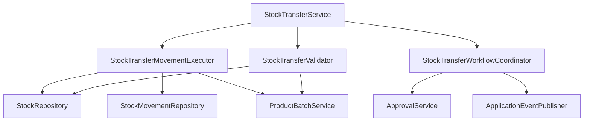

# Especificação de Decomposição - StockTransferService (Fase 95)

## 1. Contexto e Diagnóstico

O serviço `backend/src/main/java/mz/multicore/erp/modules/inventory/service/StockTransferService.java` acumulava **712 linhas** de código combinando múltiplas responsabilidades:
1. Validações semânticas de viaturas, motoristas, armazéns e disponibilidade de stock com migração preguiçosa.
2. Execução física de movimentos atómicos de stock entre armazéns, replicação FEFO de lotes e persistência em `StockMovement`.
3. Integração com workflow central de aprovações (`ApprovalService`), eventos assíncronos (`StockTransferResolvedEvent`) e avanço de estados de separação (picking).
4. Orquestração CRUD de rascunhos de transferência e consultas.

## 2. Objectivos da Refactorização

1. **Princípio da Responsabilidade Única (SRP):** Cada faceta da transferência de stock possui um colaborador dedicado.
2. **Decomposição Física:**
   - `StockTransferMovementExecutor.java` ($\le 125$ linhas): Execução atómica de movimentos de stock entre armazéns, replicação FEFO de lotes no destino, ajuste de saldos com `findForReservation` e registo de rastreabilidade em `StockMovement`.
   - `StockTransferValidator.java` ($\le 105$ linhas): Validações de armazéns, regras de motorista/matrícula, conferência de permissões e cálculo autoritativo de disponibilidade de stock com suporte a lotes legados.
   - `StockTransferWorkflowCoordinator.java` ($\le 105$ linhas): Cálculo do montante estimado da guia, submissão/cancelamento de pedidos à Central de Aprovações, publicação de eventos `StockTransferResolvedEvent` e gestão de avanço para emissão de guias de separação física.
   - `StockTransferService.java` ($\le 425$ linhas): Orquestrador central e transacional enxuto, preservando 100% de retrocompatibilidade em construtores e assinaturas.
3. **Multi-User Concurrency & Pessimistic Lock:** Preservação estrita de `Stock stock = stockRepository.findForReservation` para o `MultiUserRobustnessHarnessTest`.

## 3. Arquitectura dos Componentes

