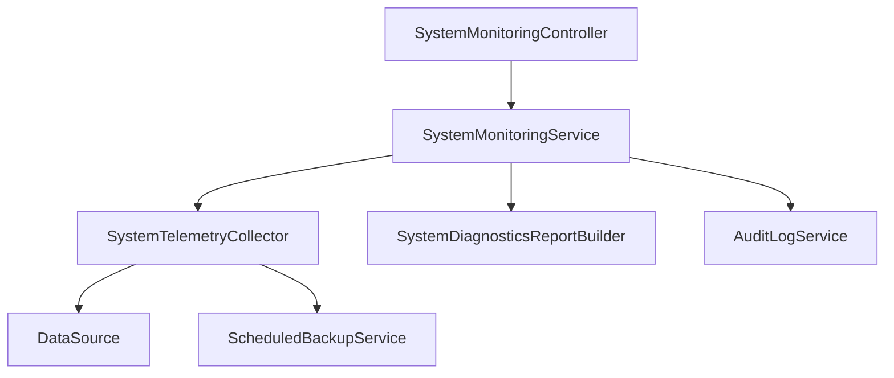

# Especificação de Decomposição - SystemMonitoringService (Fase 119)

## 1. Contexto e Diagnóstico

O serviço `backend/src/main/java/mz/multicore/erp/modules/monitoring/service/SystemMonitoringService.java` acumulava **346 linhas**, agregando múltiplas responsabilidades de infraestrutura e telemetria:
1. Recolha física de telemetria da JVM (memória heap e non-heap, thread pools, uptime, sistema operativo e versão Java).
2. Verificação de conectividade com a base de dados (ping `SELECT 1`, latência e métricas do pool HikariCP).
3. Inspeção e cálculo de integridade dos 5 subsistemas corporativos (`Base de Dados Principal`, `Motor de Faturação & POS`, `Mecanismo de Backups`, `Armazenamento de Ficheiros`, `Serviço de Licenciamento`).
4. Apuração analítica do estado global do sistema (`HEALTHY`, `WARNING`, `CRITICAL`).
5. Formatação do relatório completo de diagnóstico em ASCII estruturado com seções e variáveis de ambiente.

## 2. Objectivos da Refactorização

1. **Princípio da Responsabilidade Única (SRP):** Desacoplar a recolha física de métricas e a formatação textual em colaboradores especializados.
2. **Decomposição Física:**
   - `SystemTelemetryCollector.java` ($\le 210$ linhas): Responsável pela inspeção da JVM, ping da base de dados, pool HikariCP, armazenamento em disco e avaliação dos subsistemas operacionais e estado geral.
   - `SystemDiagnosticsReportBuilder.java` ($\le 120$ linhas): Geração estruturada do relatório textual de diagnóstico, formatação de uptime e consolidação de eventos de auditoria.
   - `SystemMonitoringService.java` ($\le 110$ linhas): Orquestrador central e fachada protegida por controlo de acesso (`PermissionGuard.requireMonitoringAdmin`), coordenando a emissão de snapshots e exportação de diagnósticos.
3. **Preservação de Contratos e Retrocompatibilidade:**
   - Construtor canónico `@Autowired` recebendo os novos colaboradores especializados.
   - Construtor retrocompatível de 5 parâmetros preservado para compatibilidade total com `SecurityPermissionGuardCoverageTest`.
   - 100% de compatibilidade com os DTOs `SystemHealthDTO` e `SystemDiagnosticsExportDTO` e endpoints REST em `SystemMonitoringController`.

## 3. Arquitectura dos Componentes

